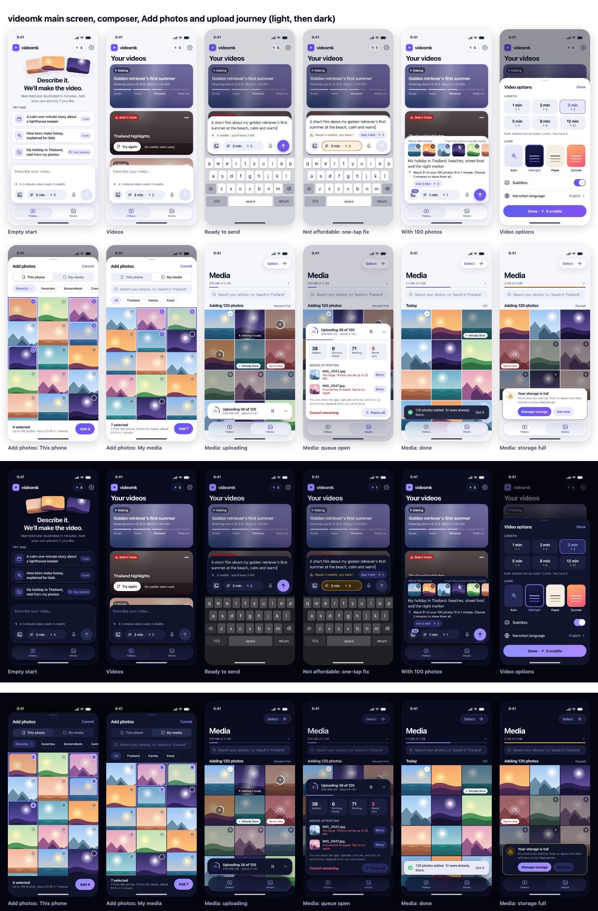

# videomk UI design: main screen, composer, Add photos, upload journey

Status: design only (no app code touched). Mockups: `docs/ui/` (HTML + 2x PNG, light and dark, 393x852). Overview: `docs/ui/overview.png`.
Mockup sources are plain HTML/CSS with inline SVG; open any `docs/ui/*.html` in a browser. All numbers below are the numbers used in the mockups.

Files per screen (each exists as `-light` and `-dark`, `.html` and `.png`):
`main-empty`, `main-with-videos`, `composer-typing-ready`, `composer-not-affordable`, `composer-with-photos`, `options-sheet`, `add-photos-sheet-this-phone`, `add-photos-sheet-my-media`, `media-uploading`, `media-upload-queue`, `media-upload-done`, `media-upload-error`.

---

## (a) Research summary

Honest scope note: I ran web searches and used what they returned. Several primary pages (Apple HIG sheets, Material 3 layout pages) came back as navigation shells with no body text, so where I cite platform numbers (44 pt, 48 dp, window size classes, detents) they are from the guidance as I know it plus the snippets below, not quoted from a fetched page. Nothing was copied from any product's branding or assets.

| Source | What I learned | Adopt / reject |
|---|---|---|
| ChatGPT mobile composer teardowns: [aiuxplayground](https://aiuxplayground.com/teardowns/chatgpt/composer), [ai-design-patterns](https://ai-design-patterns.pages.dev/teardowns/chatgpt/composer), [Android Authority on the attachment menu](https://www.androidauthority.com/chatgpt-mobile-attachment-ui-update-3631648/), [Digital Trends on long-press for recent photos](https://www.digitaltrends.com/phones/chatgpt-for-iphone-now-lets-users-grab-recent-photos-with-a-long-press/), [Digg: plus becomes X during dictation](https://digg.com/ai/4nlx6v5r) | One "+" opens one attach menu. Mic stays visible after text is typed. A teardown warns that hiding attach inside a menu hurts discovery, and a forum thread shows users angry when dictation sends before showing the text. | Adopt: ONE attach control, mic always visible, dictation fills the field and never auto-sends. Reject: hiding attach inside a "Tools" menu (the owner's whole complaint was clutter, not discoverability, so the attach control stays a visible icon with a count badge). |
| Prompt-starter research: [AI UX Playground, Prompt Starters](https://aiuxplayground.com/pattern/prompt-starters), [UX Collective, "death of the empty state"](https://uxdesign.cc/the-death-of-the-empty-state-in-ai-products-2026-e11439fbb688), [NN/g, prompt suggestions](https://www.nngroup.com/articles/prompt-suggestions/) | Vague starters ("Ask me anything") do not teach. Users ignore suggestions that are not concrete or well placed. A better empty state states the product's purpose in one line and shows worked examples with a verb. | Adopt: one-line promise, three concrete tappable examples that differ in kind (short story, explainer, one that uses photos), each showing its length. Reject: a rotating carousel of 8 prompts (more to read, less to teach). |
| Sora app: [design review](https://designcompass.org/en/2025/10/08/an-app-where-users-voluntarily-contribute-their-data), [Axios](https://www.axios.com/2025/09/30/openai-sora-app-social-ai) | Feed-first, centre "+" to create, remix by editing the prompt. Rich media cards dominate the screen. Coverage had no composer detail (I could not confirm layout). | Adopt: media cards where the picture is the hero. Reject: a social feed and a centre-plus tab (videomk is personal, two destinations are enough). |
| Runway / Luma / Pika: [Luma prompt-box settings guide](https://lumaai-help.freshdesk.com/support/solutions/articles/151000214865-check-your-settings-before-generating-a-guide-on-how-to-use-the-prompt-box), [Runway Gen-4 help](https://help.runwayml.com/hc/en-us/articles/37327109429011-Creating-with-Gen-4) | Duration, resolution and ratio are settings checked before generating, kept next to the prompt box; attached media can set the ratio automatically. No real UI teardown found. | Adopt: options live one tap from the prompt and show their current value on the control itself. Reject: exposing every setting inline. |
| Google Photos Create tab and floating bar: [9to5Google, Create tab](https://9to5google.com/2025/08/13/google-photos-create-tab/), [9to5Google, floating bottom bar](https://9to5google.com/2026/07/08/google-photos-floating-bottom-bar-android/), [Android Authority on the nav bar vs M3E guidance](https://www.androidauthority.com/google-photos-redesigned-navigation-bar-good-3686008/) | Create flows are presented as a few big tappable options; a separate round button holds the AI action. The floating bar departs from official M3E guidance for primary navigation. | Adopt: the composer is a floating card above a short bar. Reject: a floating nav bar on Android (see Material below). |
| Material 3 Expressive: [9to5Google on toolbars](https://9to5google.com/2025/05/18/material-3-expressive-toolbars/), [Compose HorizontalFloatingToolbar API](https://developer.android.com/reference/kotlin/androidx/compose/material3/FloatingToolbarDefaults) | The floating toolbar is for contextual actions on the current page, not primary navigation; it can hold a FAB. Larger corner radii, bolder type and a clear primary colour are the expressive direction. | Adopt: large radii (28 dp composer, 22 dp cards), one prominent filled primary. On Android keep the standard M3 `NavigationBar` for Videos/Media; the composer card is our "contextual floating" element. |
| Apple Liquid Glass (iOS 26): [WWDC25 323](https://developer.apple.com/videos/play/wwdc2025/323/), [WWDC25 284](https://developer.apple.com/videos/play/wwdc2025/284/), [HIG toolbars](https://developer.apple.com/design/human-interface-guidelines/toolbars), [Adopting Liquid Glass](https://developer.apple.com/documentation/technologyoverviews/adopting-liquid-glass) | Tab bar floats and can minimise on scroll; toolbar groups share a glass surface; partial sheets are inset with a glass background and can morph from the button that opened them; use glass sparingly on custom controls; prefer standard components so radii stay concentric. | Adopt: system `TabView`, system toolbar for Select/+ , system `.sheet` with detents (do not set a custom sheet background), glass only on the composer's surrounding bar and tab bar via the system. Reject: glass on cards and tiles. |
| Apple HIG sheets (known guidance; page body was not retrievable): detents `.medium`/`.large`, grabber shown when resizable, always a visible way out, 44x44 pt targets | | Adopt as written in (f). |

**Top 5 insights that drove decisions**
1. The primary action never hides: every product above keeps send/attach/mic visible; where state matters (dictation) the control changes shape, it does not vanish.
2. One attach entry, one picker. Source choice belongs inside the picker, as a segmented control.
3. Empty states teach with concrete examples that include the differentiating feature (photos).
4. Settings that change price belong next to the prompt and show their value on the control itself (the options pill shows "3 min . 3 credits").
5. Media cards that let the picture lead, with status overlaid on a scrim, feel like a product for video; list rows with a tiny thumbnail feel like a template.

---

## (b) Principles

1. **Send never disappears.** A 52 dp filled circle is always at the right end of the composer. When it cannot act it is tonal (not hidden) and a one-line reason sits directly above it. Tapping a tonal send does not do nothing: it pulses the reason line and announces it to screen readers.
2. **Price before action.** The cost is on the options pill ("3 min . bolt 3"), in the status line ("3 credits . you'll have 2 left") and on the final button of the options sheet. Balance is in the top bar. Nobody learns the price after tapping.
3. **Every problem arrives with its fix.** Not affordable: chip "Use 1 min . bolt 1". Too many photos for the length: chip "Use 2 min . bolt 2". Failed video: "Try again". Storage full: "Manage storage".
4. **One control, one job.** One attach control (picker with source switch), one options control (sheet), one mic, one send. No control carries two meanings.
5. **The picture leads.** Video cards are thumbnails with text on a scrim; media tiles are edge-to-edge photos with 2 px gaps. Chrome is quiet, so the user's content is the colour.
6. **Calm, never frantic.** Work in progress is shown as named steps ("Drawing scene 6 of 9. About 2 min left."), slow shimmer, no spinners over content, no per-photo announcements. Failures are kind and say what happens to credits.
7. **No layout jumping.** Skeletons and local previews hold the exact final size; thumbnails cross-fade in place; content never reflows under the finger.

---

## (c) Information architecture

**First screen purpose:** "make a video now". The composer is the screen; the video list is the proof that it works. It is always docked (never a modal, never a FAB that opens a screen), so the path from launch to send is: type, glance at price, tap send.

**On the screen, top to bottom**
- Top bar: logo mark + wordmark (left); credits pill and Settings gear (right). Credits pill: bolt + number, or infinity for test accounts. It stays top right (both platforms), tappable to the credits/settings area.
- Title "Your videos" (large, 30/36) when videos exist. In the empty state the hero replaces it.
- Feed of video cards (newest first) or the empty-state hero with examples.
- Composer card, docked above the bottom bar (and above the keyboard).
- Bottom bar: Videos | Media. Two destinations stay. No third tab.

**Settings:** gear in the top bar, opens the existing Settings screen unchanged. **Credits:** top-bar pill, plus price everywhere it matters.

**Role of Media:** Media is the private cloud library (upload, organise, search). It is a place to manage; the composer's Add photos sheet is a place to choose. The "My media" tab of that sheet is a read-only chooser view of the same library; uploading from the sheet is allowed (see (m)).

**Parked backlog slot ("Use my media automatically"):** lives in the composer's Options sheet, as a toggle row directly under "Look", labelled "Use my media automatically" with the helper "Finds photos in My media that match your description". When on, the attach icon shows a small sparkle badge instead of a count and the status line reads "Photos chosen from My media when you send". Not designed further; no mockup. Placement keeps the composer free of a new control.

---

## (d) The main screen in detail

### Layout at 360 dp (Android compact), 393 pt (iPhone), tablet

| Element | 360 dp | 393 pt | Tablet (>= 600 dp / iPad) |
|---|---|---|---|
| Side margin | 16 | 16 | 24; content max width 720 centred, feed in 2 columns (>= 840: 3 columns), composer max width 640 centred |
| Top bar | 52 high under status bar | 52 | 64 |
| Video card | width 328, thumbnail 328x190 | width 361, 361x190 | 2-col grid, 16:10 thumbnails (card height = width x 0.625) |
| Composer card | margin 12, radius 28, min height 164 | same | max width 640, bottom-centred |
| Bottom bar | 80 dp M3 NavigationBar (Android), pill 62 pt floating (iOS) | | Android: NavigationRail on the left from 600 dp; iOS: system sidebar-adaptable tab bar |

Vertical rhythm (393x852): status 54, top bar 52 (54 to 106), title 108 to 144, first card at 152, cards 190 high with 14 gap, composer bottom edge 10 above the bar, bar 62 high at bottom 24.

Hierarchy: 1) the composer (white card on tinted background, shadow level 3), 2) the in-progress card if any (the only saturated block), 3) ready cards, 4) chrome.

### Empty state (first launch, no videos): `main-empty`
Teaches by example, never "No videos yet".
- Three overlapped film-frame pictures (104x66, radii 14, rotated -7/0/+7 degrees) as a quiet visual, 112 pt from the top.
- Headline 28/34 bold, centred: "Describe it. We'll make the video."
- Sub 15.5/21, secondary colour: "Narrated and illustrated in minutes. Add your own photos if you like."
- Section label "TRY ONE" (13, 700, uppercase, +2% tracking).
- Three example cards, 64 high, radius 18, surface 1 + 1 px outline, icon tile 40 (radius 12, primary-container fill), 2-line text 15/20 semibold, trailing tag chip:
  1. "A calm one-minute story about a lighthouse keeper" (1 min)
  2. "How bees make honey, explained for kids" (3 min)
  3. "My holiday in Thailand, told from my photos" (Your photos, with image icon)
- **Behaviour:** tap fills the composer with the sentence (cursor at end, keyboard opens), sets the length to the tag, and does not send. Example 3 also opens the Add photos sheet immediately on the "My media" tab (or "This phone" if the library is empty). Examples disappear once the person has one video; they return in an overflow "Ideas" entry only if asked for later (not in scope).

### Feed with videos: `main-with-videos`
One card type, vertical, picture first. Radius 22, shadow level 2, 14 gap, 16 margin.

| State | Look |
|---|---|
| Ready | Thumbnail 190 high full bleed; bottom scrim (transparent at 46% to 78% navy); top-left status chip "Ready" with green dot (glass, 26 high); top-right "more" (44 target); centred 52 glass play button; title 18/23 semibold white, max 2 lines, bottom-left; meta 13 ("Yesterday"); duration chip bottom-right "1:20" tabular numerals. Tap: play. |
| Making | Background brand gradient (#2B2F9A to #6A3FC4) with the first picture blurred 16 px at 38% opacity; chip "Making"; title (generated or the prompt's first words) 19/24; line "Drawing scene 6 of 9. About 2 min left."; four step segments (Script, Voice, Pictures, Final cut): done segments solid, current partially filled, labels 12.5 under them, current label white bold; slow diagonal shimmer (see motion). No percent number, no spinner. Not tappable except to cancel via "more". |
| Failed | Picture desaturated (greyscale, 70% brightness) with red-black scrim; chip "Didn't finish" (red #B91C1C at 85%, warning icon); title; white pill button "Try again" (40 high) and the line "No credits were used." *(copy must match backend behaviour; see open questions)*. |
| Loading list | 2 skeleton cards (same 190 height, surface 2 with shimmer). |

Order: in-progress first, then newest ready; failed sorted by time with a 4 pt coloured edge not used (the chip carries it).

**Composer when scrolling:** scrolling the feed down collapses the composer to a 56 high single row (placeholder, attach, send); scrolling up or tapping expands it. Reduce motion: no animation, instant swap. The send button stays visible in both.

**Pull to refresh:** the platform control (Material `PullToRefreshBox`, SwiftUI `.refreshable`). It refreshes the list and statuses. Indicator in primary colour. Making cards update progress live without refresh (poll while visible).

---

## (e) The composer

Docked card: left/right margin 12, radius 28, surface 1 (white / #11152B), 1 px outline, shadow level 3, padding 14 top / 12 right / 10 bottom / 16 left. Rows:
1. (optional) Photo strip row: count row 12 semibold ("100 of 100 photos" left, source note right) + strip of 56x56 thumbs (radius 12, 8 gap, small x remove button 18 dp visible, 44 dp hit area via padding) ending in "+N" tile when more than fit. Horizontally scrollable.
2. Text field, 17/24, min 2 lines (48), grows to 6 lines then scrolls. Placeholder "Describe your video..." (tertiary colour).
3. **Status line** (min height 28, 13/18 medium): the single place for price, reason and fix.
4. Toolbar row (44 high controls, 8 gaps): Attach (44 circle) . Options pill (flex, 44 high, shows "sliders icon, 3 min . bolt 3") . Mic (44) . Send (52 circle).

Width check at 360 dp: 12+12 margin, 16+12 padding = inner 308. Attach 44 + gap 8 + pill (min 136) + gap 8 + mic 44 + gap 8 + send 52 = 300. Fits; below 340 dp wide the mic loses its 44x44 touch only visually (24 dp icon, 44 dp hit area) and the pill text shortens to "3 min . 3".

### States

| State | Text field | Status line | Options pill | Send | Mockup |
|---|---|---|---|---|---|
| Empty (not focused) | placeholder, 2 lines tall | "A 3 minute video costs 3 credits" (secondary, bolt icon) | normal | tonal (surface 3, icon tertiary) | `main-empty` |
| Focused, keyboard open | caret in primary colour; composer rides above keyboard (8 dp gap), bottom bar hidden | same | normal | tonal | |
| Typing, too short (< 10 characters, `Brief.MIN_LENGTH`) | text | "Add a few more words (4 to go)" (secondary) | normal | tonal; tap pulses the line | |
| Ready | text | "3 credits . you'll have 2 left" | normal | filled gradient, shadow tint | `composer-typing-ready` |
| Not affordable | text | warning colour with warning icon: "Needs 3 credits, you have 1" + chip **"Use 1 min . bolt 1"** (32 visual, 44 hit) | warning tint with 1.5 dp warning outline | tonal (visible). Tapping it pulses status line | `composer-not-affordable` |
| Too long (> 2000 characters) | text | danger: "2,140 of 2,000. Please shorten it." | normal | tonal | |
| Dictating | field shows live transcript in secondary colour; mic becomes a 44 filled danger-red stop with level ring (3 rings, 1 s pulse; static ring if reduce motion); attach and options dim to 40% and are disabled | "Listening..." | dim | Send hidden? **No**: stays, tonal, disabled until dictation stops. Dictation never auto-sends | |
| With attached photos | strip row appears above field | length hint (see below) replaces price line; price stays on the pill | normal, attach shows count badge (20 dp, primary, up to "100") | ready or reasons as above | `composer-with-photos` |
| Over photo limit | strip shows 100; extra picks blocked in the picker (see (f)) | If somehow > 100 (pasted/system): warning "Only the first 100 photos are used" + chip "Remove extras" | | ready | |
| Sending | send shows a 22 dp ring spinner inside the circle, field read-only, controls disabled | "Starting your video..." | | spinner | |
| Sent | field collapses to empty with a 200 ms fade, haptic success, the new Making card slides into the top of the feed (see motion); status line returns to default | | | tonal | |

**Photo length hint (exact copy, from the existing PhotoCapacity logic):** "About 51 of your 100 photos fit in 1 minute. Choose 2 minutes to show them all." Rendered as primary-text-colour text under the strip with a fix chip "Use 2 min . bolt 2" on its own line (hint is a tip, not blocking; send stays active). It recomputes on every length change or removal.

**Not affordable fix rule:** the chip offers the longest length that the balance allows (never 0). If the balance is 0, the chip is replaced by a primary tonal button "Add credits" opening the existing credits flow, and the status line reads "You have no credits".

### Length and look: Options sheet (`options-sheet`)
Not a cramped chip: the **options pill** is the entry (shows current length and price so the price is never hidden), and it opens a bottom sheet (Material `ModalBottomSheet` / SwiftUI `.sheet` with `.presentationDetents([.height(640), .large])`).
- Title "Video options", "Done" at the right.
- **Length**: 3x2 grid of cards 62 high (radius 16): "3 min" 17 semibold + bolt and credits (12.5). Selected: primary-container fill + 1.5 dp primary outline. Lengths 1, 2, 3, 5, 8, 12 (existing `CreateOptions.LENGTHS`). Helper under: "Each started minute costs 1 credit. You have 5." Lengths above the balance remain tappable but show the warning tint, and the sheet's primary button says "Done . bolt 8 credits" in warning colour with the not-affordable fix visible back in the composer.
- **Look**: four swatches 3:3.6 (radius 16): Auto (sparkle; "Producer decides"), Midnight, Paper, Sunrise (existing `VideoLook`). Selected: 2 dp primary outline + 3 dp container halo; label turns primary.
- **Subtitles**: row, 56 high, switch.
- **Narration language**: row with current value and chevron, opens a list sheet (same sheet component, searchable if > 8 languages).
- (Backlog slot: "Use my media automatically" row goes here.)
- Footer: full-width primary button 52 high "Done . bolt 3 credits" (credits as the price).

---

## (f) The unified Add photos sheet (`add-photos-sheet-*`)

One entry: the Attach control in the composer (and the "Add" tile at the end of the strip, and example 3 in the empty state). One sheet, `large` detent (top at 52 pt, leaving the status bar visible), medium not offered (grid needs height).

Structure, top to bottom:
1. Grabber 36x5; header "Add photos" (19 bold) left, "Cancel" right (44 target).
2. **Segmented control**: "This phone" (phone icon) | "My media" (shield icon). 40 high, radius 12, track surface 2, selected thumb surface 1 with shadow (surface 3 in dark). Android: Material `SingleChoiceSegmentedButtonRow`; iOS: `Picker(.segmented)`. **Selection persists when switching** (it is one selection set).
3. This phone: album filter chips ("Recents" with chevron opens album list, Favorites, Screenshots, Camera...). My media: **search field** 40 high with "Search your photos, try 'beach in Thailand'" (uses the library's semantic search) + album chips (All, Thailand, Family...).
4. Grid: 3 columns, 2 px gaps, square tiles (129 pt at 393). Selection: 24 dp circle top-right (white ring, dim fill) that becomes a filled gradient circle with the **selection order number**; tile gets a 3 dp primary inset ring, 12% primary wash and the photo scales to 92% (radius 10) — a clear, non-colour-only state. Tap toggles; long-press opens a full-screen preview (optional, not required for v1).
5. **Selection bar** pinned bottom (surface 1, 1 px top outline, 12 pt padding + safe area): left "7 selected" (15 bold) and subline "4 from this phone, 3 from My media. About 51 fit in 1 minute." (12.5 secondary); right primary button "Add 7" (48 high). With 0 selected the button reads "Add" and is tonal/disabled, and the subline says "Choose up to 100 photos".

### Counts and the limit
Counter is global to the composer: attached strip photos plus the new selection. Subline shows "93 of 100" when the sum goes above 80. At 100: remaining unselected tiles dim to 45% and cannot be selected; a tap on a dimmed tile shows a snackbar "You can add up to 100 photos. Remove one to choose another." Never silently ignore a tap.

### Empty and permission states
| Case | Content |
|---|---|
| This phone, no permission | Centred card in grid area: icon, "Allow access to your photos" (18 semibold), "videomk only reads the photos you pick." button "Allow access", secondary "Choose from My media". Android 14+ partial access: banner "Showing 12 photos you allowed. Manage" above the grid. |
| This phone, empty | "No photos in Recents" + chips remain |
| My media, empty library | Illustration (cloud + plus), "Your private library is empty", "Photos you add here can be reused in any video." button "Add photos to My media" (opens system picker; uploads follow (m)) |
| My media, search no match | "Nothing matches 'xyz'", "Try fewer words, like 'beach'." |
| My media, photos still processing | tiles with the shimmer skeleton and no selection circle until ready (selectable only when the server thumbnail exists) |
| Offline in My media | inline banner "You're offline. Your library is not available." This phone stays usable |

---

## (g) Design tokens

Brand: indigo to violet, refined. Primary is lighter in dark mode for contrast. Hex values below are exactly what the mockups use.

### Colour roles

| Role | Light | Dark | Notes |
|---|---|---|---|
| background | #F6F7FC | #0A0D1F | screen |
| surface1 (cards, composer, sheets) | #FFFFFF | #11152B | elevation 1 |
| surface2 (fields, pills, tonal controls) | #EEF0F9 | #1A1F3B | elevation 2 |
| surface3 (disabled send, tracks, pressed) | #E2E5F4 | #252B4D | elevation 3 |
| outline | #DADDEE | #2A3157 | 1 px borders, dividers (70%) |
| text | #11142B | #F3F4FB | |
| textSecondary | #565D78 | #A2A9C5 | |
| textTertiary (placeholder, icons) | #6C7290 | #7C84A3 | on surface1 only in light |
| primary | #4F52E0 | #9EA0FF | text, icons, selected outlines |
| onPrimary | #FFFFFF | #0A0D1F | on filled primary |
| primaryContainer | #E8E9FF | #25295A | chips, selected cards |
| gradient start / end | #5B5EF0 / #8452F4 | #8F92FF / #AE8AFF | 135 degrees; send, primary buttons, logo, toggles |
| success / container | #127035 / #DDF3E4 | #4ADE80 / #12301F | |
| warning / container | #9A4A06 / #FDF0DA | #FBBF24 / #3A2B0C | not affordable, storage |
| danger / container | #B91C1C / #FCE4E4 | #F87171 / #3B1517 | failed |
| scrim (modal) | rgba(6,8,22,.42) | rgba(0,0,0,.58) | |
| media scrim | linear-gradient transparent to rgba(8,10,28,.78) | same | on video cards, always dark |
| glass (bars) | rgba(255,255,255,.72) + blur 28 | rgba(26,31,59,.72) + blur 28 | iOS: use system material instead |
| making gradient | #2B2F9A to #6A3FC4 | same | in-progress card background |

Shadows (light / dark): level 1 `0 1 2 rgba(17,20,43,.06)` / `0 1 2 rgba(0,0,0,.4)`; level 2 `0 8 24 rgba(40,44,110,.10)` / `0 8 24 rgba(0,0,0,.45)` + 1 px white 4% ring; level 3 (composer, sheets, snackbar) `0 16 48 rgba(40,44,110,.18)` / `0 16 48 rgba(0,0,0,.6)` + 1 px white 5% ring. In Compose use `shadow(elevation, ambientColor/spotColor)` with 1/4/8 dp; on dark rely on surface lightness plus the ring, not shadow.

### Type scale (sp on Android = pt on iOS at default size; both scale with system settings)

| Style | Size / line | Weight | Android (Roboto Flex/Roboto) | iOS (SF) | Use |
|---|---|---|---|---|---|
| Display | 34/40 | 700, -3.5% tracking | headlineLarge | largeTitle (bold) | "Media" title |
| Title large | 30/36 | 700, -3% | headlineMedium | custom 30 bold | "Your videos" |
| Hero | 28/34 | 700, -3% | headlineMedium | title (bold) | empty headline |
| Title | 19/24 | 700 (sheet titles), 650 (card titles 18/23) | titleLarge | title3 | |
| Body large | 17/24 | 400 | bodyLarge (17) | body | composer text |
| Body | 15/20 | 500-600 | bodyMedium | subheadline | rows, examples, buttons 15.5 |
| Caption | 13/18 | 500 | bodySmall | footnote | status line, meta |
| Micro | 11-12.5/16 | 600 | labelSmall | caption1 | chips, badges, tab labels |
| Overline | 13/16, +2% tracking uppercase | 700 | labelMedium | caption1 | section labels |

Tabular numerals for durations, credits, counts (`fontFeatureSettings "tnum"` / `.monospacedDigit()`). Maximum line count on any chip is 1; everything else wraps (see accessibility).

### Spacing, radii, icons
- Spacing (4 pt base): 4, 8, 12, 16, 20, 24, 32. Screen margin 16 (content), sheet inner margin 20, composer inner 12/16, grid gap 2.
- Radii: 12 (fields, thumbs, segmented), 14 (small tiles), 16 (option cards, snackbar), 18 (example cards), 22 (video cards, upload bar 24), 28 (composer), 30 (sheet top), full (pills, circles).
- Blur: bars and selection bar 24-28 px (iOS system material), chips on media 8 px.
- Icons: 24x24 grid, 1.8 stroke, round caps and joins, outlined; filled only for bolt, play, tick-fill. Sizes 15 (inline with text), 18-20 (chips, rows), 24 (controls), 25 (tab bar). Android: Material Symbols Rounded weight 400 grade 0 (map names: bolt, settings, add_photo_alternate, mic, arrow_upward, tune, movie, photo_library, search, check, close, refresh, pause, schedule, cloud_upload, cloud_off, smartphone, shield, warning, auto_awesome, closed_caption, language). iOS: SF Symbols (bolt.fill, gearshape, photo.badge.plus, mic, arrow.up, slider.horizontal.3, play.rectangle, photo.on.rectangle, magnifyingglass, checkmark, xmark, arrow.clockwise, pause.fill, clock, icloud.and.arrow.up, icloud.slash, iphone, lock.shield, exclamationmark.triangle, sparkles, captions.bubble, globe).

### Motion

| What | Duration | Easing | Detail |
|---|---|---|---|
| Send press | 120 ms down, 200 ms back | spring (damping .6) | scale to .94, gradient brightens 6%, haptic impact (medium / `HapticFeedbackType.ContextClick`) |
| Send ready (tonal to filled) | 180 ms | ease-out | cross-fade fill, arrow nudges up 2 px |
| Not-ready tap | 280 ms | | status line text shakes 4 px x2 and background flashes warning container; announce reason |
| Card in (new Making card) | 320 ms | cubic-bezier(.2,.8,.2,1) | slides from composer origin (translateY 24 + fade), other cards ease down 14 px |
| Progress | segments animate width 400 ms ease-in-out; shimmer 2.4 s linear loop, 100 deg gradient, 28% white | | |
| Sheet present / dismiss | 380 ms / 260 ms | iOS system spring; Android emphasized decelerate `cubic-bezier(.05,.7,.1,1)` | scrim fades with it |
| Segmented switch | 200 ms | ease-in-out | thumb slides; grid cross-fades 150 ms; scroll position remembered per tab |
| Selection | 160 ms | ease-out | circle fills, tile scales to .92, haptic selection tick |
| Tile settle (upload done) | 280 ms | ease-out | local to server image cross-fade, tick fades after 900 ms |
| Reduced motion | all above become 0-120 ms fades; shimmer becomes a static 8% lighter fill; no scale/shake; dictation ring static |

Haptics: send (medium impact), selection toggle (light selection tick), limit reached or not-ready tap (warning notification), video finished while app open (success), upload finished (success, once). Android: `HapticFeedbackConstants.CONFIRM/REJECT/CLOCK_TICK`.

---

## (h) Component specs

- **Buttons**: Primary filled: 48 high (40 small), radius full, gradient fill, 15.5 semibold, label `onPrimary`; pressed: 90% brightness; disabled: surface3 + tertiary text, still visible. Tonal: primaryContainer fill, primary text. Text button: 44 min target, primary text. Destructive text: danger colour. Icon button: 44x44 hit area, 24 icon. Send: 52 circle (exception: bigger than 48 because it is THE action).
- **Chips**: Filter chip 34 high, radius full, 1 px outline, 13.5 semibold; selected = primaryContainer, no outline. Fix chip 32 visual (44 hit), primaryContainer, primary text, 13 bold, leading or trailing icon 13. Status chip on media 26 high glass.
- **Cards**: video card as (d). Upload bar as (m). Example cards 64 high.
- **Text field (composer)**: no inner border (card is the border), 17/24, min 2 lines, caret primary, selection handles primary. Search field: 40 high, radius 12, surface2 fill, 15 text.
- **Sheets**: radius 30 top, surface1, grabber 36x5 outline colour, header 52, content scrolls under a 1 px divider when scrolled. iOS: system `.sheet`, let the system draw the glass; no custom `presentationBackground`. Android: `ModalBottomSheet` with `shape = RoundedCornerShape(topStart=30.dp, topEnd=30.dp)`, `containerColor = surface1`, drag handle.
- **Bottom bar**: Android M3 `NavigationBar`, 80 dp, 2 items, indicator pill primaryContainer, labels always shown. iOS: system `TabView` (floating Liquid Glass on iOS 26), label always shown, optional `tabBarMinimizeBehavior(.onScrollDown)` on the feed. Mockups draw the iOS look.
- **Banners / snackbars**: Snackbar 52 min, radius 16, dark inverse surface (#23263F in light, #E9EAF6 in dark), 14.5/20 text, action 40 high primary-ish text (#B9BBFF on dark snack, #4F52E0 on light snack); 5 s unless it has an action, then 8 s. Inline banners: container colour, 16 radius, icon + text + optional action. Upload bar: (m).
- **Toggle**: 51x31, gradient on, surface3 off. Use platform Switch with brand colours.

---

## (i) Accessibility

**Touch targets:** every control has a >= 48 dp (Android) / 44 pt (iOS) hit area even where the drawing is smaller: icons 24 in 44; chips 32 in 44; remove-x 18 in 44; selection circle tile is a single full-tile target; send 52.

**Contrast (computed, WCAG 2.x):**
| Pair | Light | Dark |
|---|---|---|
| text on background | 16.9:1 | 17.6:1 |
| textSecondary on background | 6.1:1 | 8.3:1 |
| textSecondary on surface1 | 6.5:1 | 7.7:1 |
| textTertiary (placeholder) on surface1 | 4.7:1 | 4.9:1 |
| primary text on surface1 | 5.8:1 | 7.7:1 |
| primary on primaryContainer | 4.9:1 | 5.8:1 |
| onPrimary on gradient start / end | 4.9 / 4.7:1 | 7.1 / 7.2:1 |
| warning on warning container | 5.6:1 | 8.2:1 |
| danger on danger container | 5.4:1 | 5.8:1 |
| success on success container | 5.3:1 | 8.2:1 |
| white on danger (failed chip, 85% alpha over dark scrim) | 6.5:1 | |
| snackbar text / action | 13.5 / 8.2:1 | action on inverse 4.9:1 |
Rules: textTertiary is never used for information that matters (only placeholders and decorative icons) and never on the tinted background (4.4:1 there). Text on photos always sits on the media scrim (white on the 78% navy end >= 7:1). Selection, failure and ready states are never colour-only (ring + number, icon + label, dot + word).

**Screen reader labels:**
| Control | TalkBack (contentDescription / stateDescription) | VoiceOver (label / value / hint) |
|---|---|---|
| Send | "Make video" + state "Ready, costs 3 credits" or "Not ready. Needs 3 credits, you have 1. Double tap for the fix." | label "Make video", value same, hint "Starts your video" |
| Send (tonal) | role Button, disabled NOT used (stays focusable); action pulses and announces reason | `.accessibilityAddTraits(.isButton)` with `notEnabled` avoided; same |
| Attach | "Add photos. 100 selected" | "Add photos", value "100 selected" |
| Options pill | "Video options. 3 minutes, 3 credits, Midnight look, subtitles on" | same as label, hint "Opens options" |
| Fix chip | "Use 1 minute instead, 1 credit" | same |
| Mic | "Dictate" / "Stop dictation" | same, trait toggle |
| Segmented control | "This phone, tab 1 of 2, selected" | native segmented |
| Photo tile | "Photo 14, selected, number 3" / "not selected" | same |
| Selection bar | live region polite: "7 selected" | |
| Video card | "Golden retriever's first summer. Making. Drawing scene 6 of 9. About 2 minutes left." | combined element |
| Upload bar | "Uploading 38 of 120 photos. 640 megabytes left. Pause button. Expand." | |
| Tile retry | "Photo failed to upload. Double tap to retry." | |

**Font scaling to 200%:** all text in sp / Dynamic Type; composer min height becomes content height (grow, not clip); the toolbar row switches to two rows when scale >= 1.5: row 1 Attach + Options pill (full width) ; row 2 Mic + Send right-aligned; length cards become a single column list; status line may wrap to 3 lines; chips stay 1 line and truncate in the middle only for filenames; tab bar labels stay (icons grow to 32); the segmented control stacks icon above label at >= 1.5; video card title may grow to 3 lines with the card gaining height (thumbnail height fixed 190 at default, `max(190, 0.52 x width)`).

**Reduced motion:** see (g). **Other:** focus order top bar, feed, composer (field, attach, options, mic, send), bar. Dark and light both pass; support increased-contrast by switching outline to #8187A3 / #5A6290. Progress announcements are rate limited (see (m)).

---

## (j) Platform notes

**Identical on both:** layout, copy, colour roles, radii, type sizes, composer anatomy, states, status line logic, options contents, Add photos structure and counts, card designs, upload tile states, upload bar content.

**Follows each platform:**
| | Android (Material 3) | iPhone (Liquid Glass) |
|---|---|---|
| Bottom bar | `NavigationBar` 80 dp, flat, tonal | system floating tab bar (62 pt look), may minimise on scroll |
| Top actions | `TopAppBar` small, collapses; credits pill as action | large title in nav bar, system toolbar groups: credits pill, gear |
| Sheets | `ModalBottomSheet`, back gesture dismisses | `.sheet` detents, swipe down; system glass |
| Segmented | `SingleChoiceSegmentedButtonRow` | `Picker(.segmented)` |
| Photo picker | Android Photo Picker (`PickMultipleVisualMedia`) is **not** used inside our sheet; we read MediaStore with partial-access handling, because the brief wants one grid. If that is blocked on a device, fall back to launching the system picker from the "This phone" tab. | `PhotosUI` embedded picker (`PhotosPicker` with `.photosPickerStyle(.inline)` cannot show a custom selection bar); use `PHPickerViewController` full-screen inside the sheet only if the custom grid is rejected on privacy grounds (limited-library access works with the custom grid via `PHAsset` fetch) |
| Haptics | `HapticFeedbackConstants` | `UIImpactFeedbackGenerator`, `UINotificationFeedbackGenerator` |
| Snackbar | Material `Snackbar` bottom | custom toast at bottom above tab bar (iOS has no snackbar) |
| Back | system back closes sheets, collapses upload panel first | swipe-down, "Cancel" button |
| Typography | Roboto Flex / Roboto, Material roles | SF Pro (system), Dynamic Type styles |
| Dictation | `SpeechRecognizer` | `SFSpeechRecognizer`; keyboard dictation key also works |

---

## (k) Implementation checklist, priority order

Priority is by user pain. Each item has acceptance criteria (AC).

**P0 Problem 1: send never disappears**
1. Replace the conditional send drawing with an always-drawn 52 dp circle. States: tonal (not ready) and filled (ready); never `if (...) Send`.
   AC: with a 1-credit balance and a 3 min default, the send button is visible; the status line says "Needs 3 credits, you have 1"; the chip "Use 1 min . bolt 1" is visible; one tap on the chip sets length to 1 min, the status line becomes "1 credit . you'll have 0 left" and send turns filled; tapping send then starts a video. With 0 credits: "You have no credits" + "Add credits". With < 10 characters: send tonal and "Add a few more words (N to go)"; tapping it announces the reason. Test tags: keep `sendButton`, `notEnoughCredits`, `costLine`, `photosNote`, `photoCapacityHint`; add `fixChip`, `statusLine`.
2. Status line as the single source for price, reason and fix (replaces the grey hint).
   AC: exactly one status message visible at a time; priority: too long > not affordable > too short > photo hint > price.

**P0 Problem 2: one attach control, one sheet**
3. Remove the second (bookmark) icon; one Attach button with count badge.
   AC: only one attach control in the composer. Badge shows total photos from both sources.
4. Build `AddPhotosSheet` with source segmented control, shared grid and selection bar, selection retained across tabs, order numbers, search + albums in My media, 100 limit with dimming and snackbar.
   AC: picking 4 from This phone, switching to My media, picking 3 more shows "7 selected . 4 from this phone, 3 from My media", "Add 7" puts 7 thumbnails in one strip; at 100 further taps are blocked with an explanation; removing one in the strip frees a slot; hint "About 51 of your 100 photos fit in 1 minute. Choose 2 minutes to show them all." appears and updates on length change.
5. Permission and empty states per (f). AC: denied permission shows the card and My media remains usable.

**P1 Problem 3: the screen**
6. Tokens (colour, type, radii, shadow) in `Theme.kt` / `Theme.swift` exactly as (g).
7. Composer card (docked, two-row, options pill, status line) and Options sheet. AC: price visible on the pill at all times; options sheet shows length cards with credits, look swatches, subtitles, language; "Done . bolt N credits".
8. Video cards (Ready/Making/Failed) and feed header; skeleton loading; pull to refresh. AC: in-progress shows step segments and "Drawing scene X of Y. About N min left."; failed shows "Try again" and re-queues the same request.
9. Empty state with three tappable examples. AC: tapping example 3 fills the text and opens Add photos; none of them sends.
10. Composer collapse on scroll, tablet layouts (2 columns, rail), dictation state, dark mode QA.

**P1 Upload journey (see (m))**
11. Optimistic tiles, per-tile states, no-jump swap, upload bar, summary snackbar, error and offline handling, resume after relaunch, composer flow-back.
    AC: see (m) acceptance list.

**P2:** accessibility pass (200% scale, TalkBack/VoiceOver walkthrough), reduced motion, haptics, tablet QA, increased contrast.

---

## (m) Media upload journey

Context from the owner: today a plain progress banner appears on top and, after it completes, nothing shows in the gallery until the server finishes preparing each photo (a few seconds) — a functional bug fixed separately. This design makes the wait feel intended instead of broken, and it still works if that fix lands first or second.

Mockups: `media-uploading` (collapsed bar, mixed tile states), `media-upload-queue` (expanded panel), `media-upload-done` (summary), `media-upload-error` (storage full).

### 1. Starting
The "+" in the Media toolbar pill ("Select | +") opens the system picker (PHPicker / Android Photo Picker, multi-select, up to the remaining storage-friendly batch; no cap on count in the picker itself, the queue handles hundreds). On confirm, the picker closes and **the same frame** shows the new tiles; the user is never left on an empty screen.

### 2. In the grid: local pictures first, newest first
- A section header "Adding 120 photos" (17 bold) with "Newest first" (13 secondary) is inserted at the top of the grid. Under it, tiles for every picked photo are shown immediately, rendered from the **local file** (downscaled 400 px, decoded off the main thread; for huge selections render the first 60 tiles eagerly and the rest as flat surface2 tiles until scrolled into view).
- Tile size never changes: square, grid cell. The server thumbnail replaces the local image **inside the same square with a 280 ms cross-fade**; both are `ContentScale.Crop` / `.aspectRatio(1, contentMode: .fill)` so the crop is identical, no reflow.
- When all tiles of the batch are done the section header collapses into the normal month header ("Today 120") with a 200 ms height animation.

| Tile state | Look | Interaction |
|---|---|---|
| Queued | local photo at 55% saturation, +28% navy dim, small clock badge top-right (24 circle) | none (long-press: "Remove from queue") |
| Uploading | +38% navy dim, centred 44 dp progress ring (3 dp stroke, white on 35% white track, arrow-up inside), ring is determinate per file | none |
| Processing ("Getting it ready") | full-colour local photo, soft diagonal shimmer (2.4 s loop), bottom-left glass label "Getting it ready" with sparkle icon. Label shown only when <= 12 tiles are visibly processing; otherwise only the shimmer, to keep the grid calm | none |
| Done | cross-fade to server thumbnail; a white circle with green tick (24) top-right for 900 ms then fades (no permanent badge); a 1.02 to 1.0 settle scale in 280 ms | tap opens photo |
| Failed | greyscale + red 55% wash, centred 44 retry circle, white pill "Tap to retry" (danger text) | tap retries that file; the reason is in the queue panel |
| Already there | +38% dim, white pill "Already there" with a tick; stays 4 s, then the tile collapses out (200 ms) so the duplicate never takes a grid slot; the existing photo is where it was | tap while visible scrolls to and flashes the original |
| Waiting (paused / offline / storage) | 50% saturation, dim, pause badge | none |

Processing duration is 2 s to 10 s: while the server thumbnail is missing the tile keeps the local picture + shimmer. If a photo takes > 30 s the label changes to "Still getting it ready" and after 2 min to a quiet "Taking longer than usual" with tap-to-refresh. **The grid is never empty:** on a cold open with the library loading, show 12 skeleton tiles (surface2 with shimmer); after a relaunch mid-upload, restored queue tiles come from the persisted local copies (below).

### 3. One persistent, collapsible upload bar
Replaces the top banner. A card docked above the bottom bar (12 margin, radius 24, surface1, 1 px outline, shadow level 3), visible on Media (and a compact version in Videos, see below).
- **Collapsed (68 + 3 px progress line):** progress ring 40 (determinate overall, cloud-up icon) . "Uploading 38 of 120" (15 bold) . "640 MB left . about 4 min" (13 secondary) . Pause/Resume icon button (44) . Expand chevron (44). The thin line along the bottom repeats the overall progress. Tapping the card expands it.
- **Expanded (panel, ~370 high, scrim 18%):** same header; four stat tiles (Added 38, Getting ready 6, Waiting 71, Need you 5 in danger colour); "NEEDS ATTENTION" list: thumbnail 44, file name, one-line kind reason ("Too large. Photos can be up to 25 MB.", "Connection dropped. Tap to try again.", "Format not supported"), "Retry" tonal chip; footer text "You can close the app. Uploads carry on, and pick up where they stopped when you come back." then "Cancel remaining" (danger text, asks "Cancel 71 uploads? Photos already added stay.") and "Pause all" tonal button. Collapse with chevron, back gesture or tap outside.
- **Pause / resume:** pause stops starting new files and lets in-flight files finish (copy: "Pausing after the current photos"); bar reads "Paused . 38 of 120" with a Resume button.
- **Cancel:** removes queued files and aborts in-flight; added photos stay; tiles of removed files disappear (no failed tiles).
- **Per-item errors:** never block the rest. Failed ones are counted in the bar ("5 need you"), the bar turns amber when > 0 and the upload has finished.
- **Offline:** bar becomes neutral-warning: cloud-off icon, "Waiting for a connection", "62 photos will upload automatically" and no spinner; tiles go to Waiting state. Resumes by itself when the network returns; if on cellular and "Wi-Fi only" is set, the text is "Waiting for Wi-Fi . Upload now" (button overrides once).
- **Storage full (`media-upload-error`):** the bar becomes a taller warning card: warning icon in container circle; **"Your storage is full"**; "62 photos are waiting. Free up space and they will carry on by themselves."; buttons **"Manage storage"** (primary; opens the existing Storage sheet) and "Not now" (collapses to the compact warning bar). The storage meter under the title fills with the warning colour ("2 GB of 2 GB"). Photos already added are untouched; waiting tiles show the pause badge. After storage is freed the queue resumes without any button.
- **App closed and reopened:** the queue (file references + state) persists. On the OS backgrounding, in-flight uploads use the platform background mechanisms (iOS background `URLSession`; Android WorkManager expedited/foreground service with a progress notification "Uploading 38 of 120"). On reopen the bar reappears within one frame with "Resuming 38 of 120"; completed photos appear as normal server tiles, interrupted ones continue; if the OS purged the local file, that item moves to Needs attention with "The original is no longer available". If the user swipes the app away, copy in the panel stays true ("pick up where they stopped when you come back") because the queue is persisted even when the OS kills the process.
- **On Videos tab** while uploading: a slim 36 dp pill above the tab bar ("Uploading 38 of 120") that opens Media. Hidden while the composer has focus.

### 4. Completion
- Bar collapses and is replaced by a snackbar/toast: **"120 photos added. 12 were already there."** (action "Got it"; 8 s). If none were duplicates: "120 photos added." If some failed: "108 photos added. 5 need your attention." with action "Review" (opens the queue panel). Haptic success once.
- Only one summary per batch, never one per photo.
- **From the composer's Add photos sheet:** when the person taps "+" ... in the sheet's My media tab ("Add photos to My media" in the empty state, or a "+" in the header of that tab) the system picker returns the photos, they enter the same queue, and the sheet stays open showing those tiles at the top of the grid in the Uploading/Processing state, **auto-selected** (numbered) so the selection bar already reads "12 selected". They become tappable/addable as soon as they are Done; "Add 12" is enabled when all selected are Done, otherwise the button reads "Add 12 . 5 getting ready" and adds the finished ones immediately and the rest as they finish (the strip shows them with the same ring/shimmer tiles, send is allowed only when each is Done; the status line says "Waiting for 5 photos to finish" with send tonal). The same upload bar appears above the selection bar inside the sheet (compact only).

### 5. Accessibility and motion for uploads
- Progress is announced **politely, at most every 10% or 15 seconds, whichever is later**, as one message: "Uploaded 38 of 120 photos." Never per photo. State changes announced immediately but once: "Upload paused", "Waiting for connection", "Storage is full", "120 photos added. 12 were already there."
- Tiles are not individually announced while uploading; the grid container carries "Adding 120 photos, 38 done". After completion tiles are normal photos. A failed tile exposes "Photo failed to upload. Double tap to retry."
- Reduced motion: shimmer becomes a static lighter fill, ring updates without animation, cross-fade becomes an instant swap (0 ms), tick shows 900 ms without scale, tile collapse is instant.
- 200% text: the bar becomes two rows (title/sub, then controls); stat tiles stack 2x2; error rows wrap.

### Acceptance criteria
1. Picking 120 photos shows 120 tiles in the grid on the next frame, newest first, before any network response.
2. Each tile moves queued, uploading (ring), processing (shimmer + "Getting it ready"), done (cross-fade, tick fades) without any tile changing size or the grid shifting.
3. A skeleton or local image is shown at all times; the grid is never empty during upload or load.
4. One upload bar; collapsed shows "38 of 120 uploaded"-style count, bytes left, pause/resume; expanded lists per-file errors with Retry.
5. Offline and storage-full have the exact states above; storage-full offers "Manage storage" in one tap.
6. Kill and relaunch mid-upload: bar returns, finished photos remain, queue continues.
7. Completion shows exactly one summary message with the duplicate count.
8. Screen reader hears polite aggregated progress, not per-photo chatter; reduce motion honoured.

---

## Open questions and risks

- **"No credits were used" on failed videos** is a copy assumption. If the backend does not refund automatically, use "Credits returned to your balance" or remove the line. The mockup shows the kind version.
- **Android in-sheet "This phone" grid** needs MediaStore access and partial-photo-access handling on Android 14+; fallback to the system Photo Picker is described in (j). iOS limited-library works with `PHAsset`.
- **Floating iOS tab bar** minimising on scroll can collide with the docked composer: test `tabBarMinimizeBehavior` before enabling; the composer should stay above the bar in either state.
- **Add credits flow**: I assumed an existing credits/purchase screen reachable from the pill; confirm it exists before the "Add credits" button ships.
- **Processing-time labels** assume the server exposes a per-photo "processing / ready" state; if only the library list changes, the client has to poll the library every 2 s while any tile is processing.
- Look swatches are abstract; real previews of each look would be better once sample frames exist.
- The language list and "Wi-Fi only" setting are not specified further.
